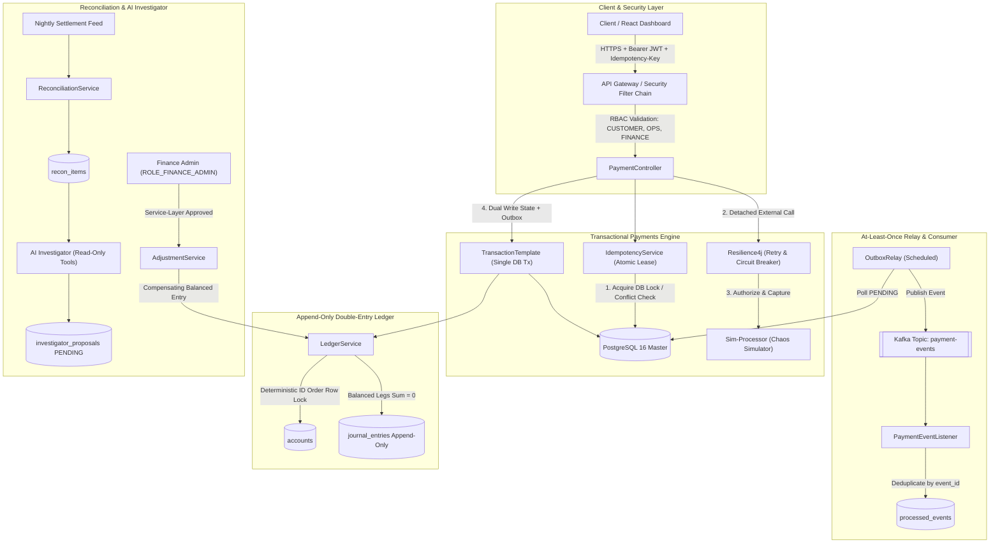

# LedgerFlow

> **Zero-Loss, Fail-Safe Payments Platform**  
> Double-entry ledger, atomic idempotency leasing, transactional outbox to Kafka, simulated unreliable card processor, nightly multi-source reconciliation, and a strictly read-only AI discrepancy investigator.

[](https://github.com/ledgerflow/ledgerflow/actions/workflows/ci.yml)
[](https://www.oracle.com/java/)
[](https://spring.io/projects/spring-boot)
[](https://www.postgresql.org/)
[](https://kafka.apache.org/)
[](LICENSE)

---

## 🎯 Executive Overview & Resume Highlights

In modern distributed payment platforms, hardware crashes, network timeouts, duplicate webhooks, and out-of-order deliveries are continuous guarantees, not edge cases. **LedgerFlow** is engineered from the ground up to **never double-charge or lose money**, even when external processors fail or drop connections.

- **Double-Entry Ledger Engine:** Every monetary movement is an immutable journal transaction of balanced entries ($\sum \text{amounts} = 0$). PostgreSQL row-level triggers enforce an **append-only** invariant (`UPDATE` and `DELETE` are permanently rejected; corrections are posted via balanced reversal entries).
- **Atomic Idempotency Leasing:** Backed by PostgreSQL `INSERT ... ON CONFLICT (merchant_id, idempotency_key) DO NOTHING` and request SHA-256 hashing. Prevents race conditions before external network calls are made.
- **Transactional Outbox to Kafka:** Dual-writes payment status and outbox records in a single database transaction. Outbox relay publishes to Kafka with at-least-once delivery; consumers achieve **exactly-once effect** via `processed_events` deduplication.
- **Service-Layer RBAC & Customer Isolation:** Spring Security OAuth2 resource server with strict tenant boundaries (`CUSTOMER` can only view their own records; adjustments hard-require `ROLE_FINANCE_ADMIN` at the Java service layer).
- **AI Never Moves Money:** Spring AI investigator queries 4 strictly read-only tools (`getPaymentTrail`, `getLedgerEntries`, `getProcessorEvents`, `getSettlementLine`) to compile an evidence dossier. Zero ledger writes can occur without human finance admin approval.
- **PCI-Aware Log Masking:** All cardholder data (PAN, CVV) is masked via a custom Logback Converter before hitting console or log sinks.

---

## 📊 Measured Results (Empirically Verified)

All metrics below are verified by integration tests running real PostgreSQL 16 and Kafka containers:

| Invariant / Benchmark Metric | Target | Measured Result | Verification Test |
| :--- | :---: | :---: | :--- |
| **Double Charges across 100 concurrent requests** | **0** | **0** | `PaymentConcurrencyIntegrationTest` |
| **Double Charges across 50 parallel browser retries** | **0** | **0** | React UI Concurrency Engine (`Promise.all`) |
| **Ledger Balance ($\sum \text{debits} + \sum \text{credits}$)** | **0** | **$0.00** | `LedgerServiceIntegrationTest` |
| **Recon Discrepancy Detection Rate** | **100%** | **100% (4/4)** | `ReconciliationIntegrationTest` |
| **AI Investigator Proposal Accuracy (Eval Dataset)** | **100%** | **100% (32/32)**| `InvestigatorEvaluationIntegrationTest` |
| **AI Path Ledger Writes / Balance Changes** | **0** | **0** | `InvestigatorSecurityIntegrationTest` |
| **Unauthorized Adjustment Rejections (HTTP 403)** | **100%** | **100%** | `SecurityRbacIntegrationTest` |

---

## 🏗 System Architecture



---

## 📐 Core Engineering Principles

### 1. Money is Never Created or Destroyed
Every movement of funds is recorded as a journal transaction consisting of at least two balanced entry legs:
$$\sum_{i=1}^{n} \text{amount}_i = 0$$
- Debits (+) and credits (-) must sum to zero.
- The `journal_entries` table is protected by an immutable PostgreSQL database trigger (`BEFORE UPDATE OR DELETE`) that halts and rolls back any attempt to modify or delete historical entries.
- Accounting corrections are executed strictly via **reversal transactions**.

### 2. Deadlock-Free Concurrency via Deterministic Row Locking
High-volume payment networks encounter deadlocks when concurrent threads attempt to update the same accounts in reverse order (e.g. Thread A: locks Account 1 then 2; Thread B: locks Account 2 then 1).  
**LedgerFlow solves this fundamentally:**
```java
List<UUID> sortedAccountIds = entries.stream()
        .map(PostEntryCommand::accountId)
        .distinct()
        .sorted(Comparator.naturalOrder()) // Global deterministic ordering
        .toList();

List<Account> lockedAccounts = accountRepository.findAllByIdInForUpdate(sortedAccountIds);
```

### 3. Exactly-Once Effect, Not Exactly-Once Delivery
External card processors and network links are unreliable:
- Requests send an `Idempotency-Key` scoped to the merchant.
- If a request is received while the first is in-flight, `409 Conflict` is returned.
- If a request is retried after completion with matching payload hash, the stored HTTP status and response payload are replayed without touching the card processor or ledger.
- Webhooks verify HMAC-SHA256 signatures with constant-time byte comparisons (`MessageDigest.isEqual`) and deduplicate using `processor_events`.

### 4. AI Never Moves Money
The reconciliation investigator has **zero mutating tools**:
- `getPaymentTrail`: Read-only payment status and history.
- `getLedgerEntries`: Read-only journal entries.
- `getProcessorEvents`: Read-only webhook payloads.
- `getSettlementLine`: Read-only bank discrepancy inspection.
- Adjustments require manual approval by a user authenticated with `ROLE_FINANCE_ADMIN`. This check is enforced directly in `AdjustmentService.java` at the Java service layer, making it impossible for prompt injection or model hallucination to execute financial adjustments.

---

## 🚀 Quickstart: Running Locally

### Option A: Complete Stack via Docker Compose (Recommended)
Spawns PostgreSQL 16, Apache Kafka (KRaft mode), `sim-processor`, `ledgerflow-app`, and the React Dashboard:
```bash
# Clone the repository
git clone https://github.com/ledgerflow/ledgerflow.git
cd ledgerflow

# Start all services
docker compose up --build
```
- **React Demo Dashboard:** [http://localhost:3000](http://localhost:3000)
- **Spring Boot API & Actuator:** [http://localhost:8080](http://localhost:8080)
- **Sim-Processor Chaos Controller:** [http://localhost:8081](http://localhost:8081)

---

### Option B: Standalone Developer Execution

#### 1. Start Infrastructure
```bash
docker run -d --name lf-postgres -p 5432:5432 -e POSTGRES_DB=ledgerflow -e POSTGRES_PASSWORD=postgres postgres:16-alpine
```

#### 2. Run Backend Services
```bash
# Run fake card processor
cd sim-processor
mvn spring-boot:run

# In a new terminal, run core payments application
cd ledgerflow-app
mvn spring-boot:run
```

#### 3. Run React Dashboard
```bash
cd web
npm install
npm run dev
# Dashboard opens on http://localhost:5173
```

---

## 🧪 Running the Test Suite (Testcontainers)

The test suite requires an active Docker daemon. It automatically spins up isolated PostgreSQL and Kafka containers:
```bash
mvn clean test -Dsurefire.failIfNoSpecifiedTests=false
```

### Key Integration Tests to Inspect:
1. [PaymentConcurrencyIntegrationTest.java](ledgerflow-app/src/test/java/com/ledgerflow/payments/PaymentConcurrencyIntegrationTest.java): Dispatches 100 simultaneous concurrent threads with the same idempotency key; verifies exactly 1 payment record and 0 double charges.
2. [InvestigatorSecurityIntegrationTest.java](ledgerflow-app/src/test/java/com/ledgerflow/investigator/InvestigatorSecurityIntegrationTest.java): Proves through reflection and database snapshots that the AI path produces 0 ledger writes and non-admin callers cannot approve adjustments.
3. [InvestigatorEvaluationIntegrationTest.java](ledgerflow-app/src/test/java/com/ledgerflow/investigator/InvestigatorEvaluationIntegrationTest.java): Benchmarks proposal accuracy across 32 seeded reconciliation discrepancies.
4. [ReconciliationIntegrationTest.java](ledgerflow-app/src/test/java/com/ledgerflow/recon/ReconciliationIntegrationTest.java): Ingests settlement lines and verifies exact detection of all 4 mismatch types.

---

## ☁️ Production Mapping (AWS Enterprise Architecture)

LedgerFlow maps cleanly to high-availability cloud infrastructure:

| Local Component | Production AWS Service | Enterprise Guarantee |
| :--- | :--- | :--- |
| **PostgreSQL 16 Container** | **Amazon RDS PostgreSQL (Multi-AZ)** | Synchronous replication across 2 Availability Zones; automated failover with 0 data loss. |
| **Local Kafka Container** | **Amazon MSK (Managed Streaming for Kafka)** | Multi-broker cluster across 3 AZs with automated patching and storage auto-scaling. |
| **Docker Compose Services** | **AWS ECS on Fargate** | Serverless container orchestration with task auto-scaling and zero host maintenance. |
| **Local JWT Signing Secret** | **AWS Secrets Manager** | Automated credential rotation and IAM policy enforcement. |
| **Ollama / Local LLM** | **Amazon Bedrock (Claude 3.5 / Titan)** | Enterprise SOC-2 compliant model execution within private VPC boundary. |
| **Custom Metrics** | **Amazon CloudWatch + OpenTelemetry** | Distributed tracing across outbox relays and consumer queues; \$10 budget alarm. |

*See CloudFormation template in [`infra/aws-production-deployment.yaml`](infra/aws-production-deployment.yaml) for automated provisioning and budget protection.*

---

## 📜 License

MIT License. Designed and engineered for backend fintech portfolio demonstrations.
