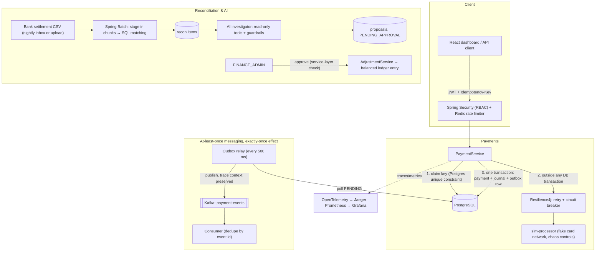

# LedgerFlow

> A payments platform built to never double-charge or lose money, even when everything around it fails.
> Double-entry ledger, idempotent payment API, transactional outbox to Kafka, a deliberately unreliable
> card processor, nightly Spring Batch reconciliation, and a read-only AI investigator for mismatches.

Java 21 · Spring Boot 3.4 · PostgreSQL 16 · Kafka · Redis · Spring AI · Spring Batch · Resilience4j ·
OpenTelemetry · React + TypeScript · Testcontainers · Toxiproxy

The point of the project is to **prove** correctness under failure with tests and a clickable demo, not
to build a real bank.

---

## What is verified, and how

Every row is an automated test against real PostgreSQL, Kafka and Redis containers (Testcontainers),
except the last two rows, which were measured on the running Docker Compose stack.

| Property | Result | Evidence |
| :--- | :--- | :--- |
| 100 concurrent requests, same Idempotency-Key | exactly 1 payment | `PaymentConcurrencyIntegrationTest` |
| Journal always balances | sum of all entries = 0 | asserted in the ledger, payment, approval, recon and fault tests |
| Every account balance equals the sum of its journal entries | 0 mismatched accounts | `AccountBalanceMatchesJournalIntegrationTest` |
| Card processor charges but replies too late | 503 (not a decline); retry with same key → 1 payment, processor charged once | `ProcessorNetworkFaultIntegrationTest` (Toxiproxy latency) |
| Card processor unreachable | 503, nothing charged, circuit opens and fails fast, recovers | `ProcessorNetworkFaultIntegrationTest` (Toxiproxy disabled) |
| Same Idempotency-Key used by two merchants | two separate processor charges | `ProcessorNetworkFaultIntegrationTest` |
| Settlement file with injected mismatches | each of the 4 mismatch types flagged exactly once; malformed lines skipped | `SettlementReconciliationJobIntegrationTest` |
| AI investigator writes to the ledger | never (0 entries, 0 balance changes) | `AiInvestigatorIntegrationTest`, `InvestigatorSecurityIntegrationTest` |
| AI picks a disallowed action, is prompt-injected, returns garbage, leaks a card number, or is down | rejected by guardrails; deterministic rules used instead | `AiInvestigatorIntegrationTest`, `AiProposalGuardrailsTest` |
| App crashes mid-payment, client retries later | the expired claim is taken over; if the payment was already saved, the same payment is returned | `StaleIdempotencyLeaseIntegrationTest` |
| Approving a proposal twice / concurrently (20 threads) | adjustment posted exactly once; second approval gets 409 | `ProposalApprovalSafetyIntegrationTest` |
| Customer tries to charge another customer's account | 403, no money moves | `PaymentOwnershipIntegrationTest` |
| Payment burst beyond rate limit | 429 with Retry-After; Redis outage does not block payments | `PaymentRateLimit*IntegrationTest` |
| 4 outbox relays running at once (e.g. 4 app instances) | every event published exactly once (`FOR UPDATE SKIP LOCKED`) | `OutboxRelayConcurrencyIntegrationTest` |
| A payment's trace survives the outbox | same trace id on the Kafka record as on the HTTP request | `OutboxTracePropagationIntegrationTest` |
| Live: 50 parallel requests from the dashboard path, same key | 1 payment in DB; 1 × 201, 49 × 409 (in progress) | measured on `docker compose up` |
| Live: AI investigation with a local model (qwen2.5:7b via Ollama) | valid proposal in ~16 s, labelled `AI_MODEL`, amount computed by code | measured on `docker compose up` |

`mvn test` runs 120 tests (117 in the app, 3 in the processor simulator).

---

## Architecture



Modular monolith (`ledgerflow-app`, packaged by feature: `payments`, `ledger`, `processor`, `recon`,
`investigator`, `audit`, `security`) plus the `sim-processor` fake card network and the `web` dashboard.

---

## Design principles

**1. Money is never created or destroyed.** Every movement is a journal transaction whose entries sum to
zero. `journal_entries` is append-only, enforced by a PostgreSQL trigger that rejects `UPDATE` and
`DELETE`; mistakes are fixed with reversal entries. Opening balances come from an `EXTERNAL-FUNDING`
account through a normal balanced transaction, so every account balance equals the sum of its entries.
Account rows are locked with `SELECT … FOR UPDATE` in a fixed order (sorted ids) in the same transaction
that writes the entries, which avoids deadlocks.

**2. PostgreSQL is the source of truth.** Idempotency, payment state and balances live in Postgres.
Redis is only used for rate limiting; if Redis is slow or down the limiter lets requests through (and
counts the error), because idempotency and balance checks in Postgres still protect the money.

**3. Exactly-once effect, not exactly-once delivery.**
- `Idempotency-Key` is scoped per merchant and backed by a unique constraint: same key + same body →
  stored response; same key + different body → 422; same key while in flight → 409. An in-flight claim
  is a 30 s lease: if the holder crashed, a later retry takes it over, and a unique index allows at most
  one payment per claim.
- The card processor call happens outside any database transaction. Its idempotency key is
  `merchantId:key`, identical across retries, so Resilience4j retries can't double-charge.
- If the processor doesn't give a definite answer (timeout, 5xx, circuit open), the API returns **503,
  not a decline**, and releases the key so the client's retry runs again and the processor replays the
  original charge. Nightly reconciliation is the backstop.
- Payment state and its outbox event commit in one transaction; a relay publishes to Kafka; consumers
  dedupe by event id. Webhooks are HMAC-verified (constant-time compare) and deduped.

**4. AI never moves money.** The investigator (Spring AI; Ollama locally, Amazon Bedrock in production)
can only call read-only lookups (`lookupPayment`, `lookupLedgerEntries`, `lookupProcessorEvents`,
`lookupSettlementLine`). It returns a root cause, an action from a closed list and a rationale; **it never
returns an amount**: amounts are computed by code. Its answer is validated in code (allowed actions per
mismatch type, adjustment direction must match bank − ledger, no card numbers). Anything invalid falls
back to deterministic rules. Only `ROLE_FINANCE_ADMIN` can approve, checked in the service layer, and
only adjustment actions post ledger entries. The AI call runs outside any DB transaction.

**5. PCI-aware.** Only tokens (`tok_…`) are accepted; a Logback converter masks 13–19 digit sequences
as `[REDACTED_PAN]`, with a test proving it.

---

## Domain rules

- **Money:** `long` minor units (cents) + ISO-4217 code. Never `double`/`float`. Settlement CSV amounts
  must be whole minor units: `12.50` is rejected, not truncated.
- **Time:** `Instant`, stored in UTC.
- **Payment state machine** (enforced in the domain layer, with a test for every allowed/illegal pair):
  `INITIATED → AUTHORIZED → CAPTURED → SETTLED`; `INITIATED|AUTHORIZED → FAILED`;
  `CAPTURED|SETTLED → REVERSED`.
- **Reconciliation mismatch types:** `MISSING_IN_BANK`, `MISSING_IN_LEDGER`, `AMOUNT_MISMATCH`,
  `DUPLICATE_SETTLEMENT`.
- **Errors:** RFC 7807 `application/problem+json`.
- **Roles:** `CUSTOMER` (own payments only), `OPS_AGENT` (recon, investigations, chaos controls),
  `FINANCE_ADMIN` (everything, including approving adjustments). Every endpoint declares its role;
  anything unlisted is denied.

---

## Run it locally

Requires Docker. Optional: [Ollama](https://ollama.com) with a tool-calling model for the real AI
investigator (`ollama pull qwen2.5:7b`). Without it, investigations fall back to the rule engine.

```bash
docker compose up --build
# if port 5432 is already used on your machine:
POSTGRES_HOST_PORT=55432 docker compose up --build
```

| What | Where |
| :--- | :--- |
| Dashboard | http://localhost:3000 |
| API + actuator | http://localhost:8080 |
| sim-processor | http://localhost:8081 |

Observability (optional):

```bash
docker compose --profile observability up --build
```

Grafana http://localhost:3001 (admin/admin, "LedgerFlow Overview" dashboard), Jaeger
http://localhost:16686, Prometheus http://localhost:9090. Every log line carries `[traceId,spanId]`.

> **Demo mode.** Docker Compose sets `LEDGERFLOW_DEMO_AUTH_ENABLED=true`, which turns on
> `POST /api/v1/auth/demo-token` so the dashboard's persona switcher can get a token for any role. It is
> **off by default**; never enable it outside a local demo.

---

## Two-minute demo

1. **Idempotency under a burst.** As *Customer (Alice)*, click **Fire 50 Concurrent Retries**. All 50
   requests share one Idempotency-Key. Expect **1 payment created**; the rest are `409` (still in
   progress) or replays of the stored `201`. **Double charges: 0.**
2. **Processor failure.** Switch to *Ops Agent*, open **Chaos & Resilience Controls**, set the failure
   rate to 100% and apply. A new payment returns **503 "Card Processor Unavailable"**, not a decline.
   Set it back to 0% and retry. The payment succeeds, once.
3. **Books balance.** The **Double-Entry Ledger** tab shows the zero-sum check across all accounts.
4. **Reconciliation + AI + approval.** As *Ops Agent*, open **Reconciliation** and click **Trigger
   Nightly Reconciliation Batch** (4 injected mismatches). Click **Investigate with AI** on the
   `AMOUNT_MISMATCH` row: a proposal appears, labelled *AI model* or *Rule engine*, with its action,
   rationale and the amount code computed. **Approve proposal** as Ops is rejected (`403`); switch to
   *Finance Admin* and approve: the balanced compensating entry is posted and the ledger still balances.
   On `DUPLICATE_SETTLEMENT` / `MISSING_*` rows, approval records the decision but moves no money.

The same flow over the API:

   ```bash
   T=$(curl -s -X POST localhost:8080/api/v1/auth/demo-token -H 'Content-Type: application/json' \
         -d '{"username":"ops","role":"ROLE_OPS_AGENT"}' | jq -r .accessToken)
   ITEM=$(curl -s localhost:8080/api/v1/recon/items -H "Authorization: Bearer $T" \
         | jq -r '[.[] | select(.mismatchType=="AMOUNT_MISMATCH")][0].id')
   curl -s -X POST localhost:8080/api/v1/investigator/investigate/$ITEM -H "Authorization: Bearer $T" | jq
   # -> proposal with generatedBy AI_MODEL (or RULES), PENDING_APPROVAL.
   # Approve with a FINANCE_ADMIN token: POST /api/v1/investigator/approve-proposal?proposalId=...
   # -> posts the balanced compensating entry; approving again returns 409.
   ```

---

## Tests

```bash
mvn test        # needs a running Docker daemon
```

Places to start reading:
- `ProcessorNetworkFaultIntegrationTest`: real HTTP client + Resilience4j through Toxiproxy.
- `PaymentConcurrencyIntegrationTest`: 100 threads, one key, one payment.
- `AiInvestigatorIntegrationTest`: scripted model returns valid, wrong, injected and failing answers.
- `SettlementReconciliationJobIntegrationTest`: the Spring Batch job, chunking, skips, restart.
- `ProposalApprovalSafetyIntegrationTest`: double and concurrent approvals.

---

## Production mapping (AWS)

| Local | AWS |
| :--- | :--- |
| PostgreSQL container | Amazon RDS for PostgreSQL (Multi-AZ) |
| Kafka container | Amazon MSK |
| Redis container | Amazon ElastiCache for Redis |
| Docker Compose services | Amazon ECS on Fargate |
| Ollama | Amazon Bedrock (`AI_CHAT_PROVIDER=bedrock-converse`, `BEDROCK_MODEL_ID`) |
| Jaeger / Prometheus / Grafana | Any OTLP backend (e.g. AWS X-Ray via ADOT), Amazon Managed Prometheus / Grafana |
| Demo JWT secret | A real identity provider; secrets in AWS Secrets Manager |

A CloudFormation sketch with a billing alarm is in [`infra/aws-production-deployment.yaml`](infra/aws-production-deployment.yaml).

---

## Known limitations

Honest list of what is not done yet:
- If the processor approves but the database write then fails, the charge has no ledger record until
  reconciliation flags it (`MISSING_IN_LEDGER`); there is no automatic compensation.
- A default JWT signing secret is in the code for local use; production must override it.

---

## License

No license file has been chosen yet.
